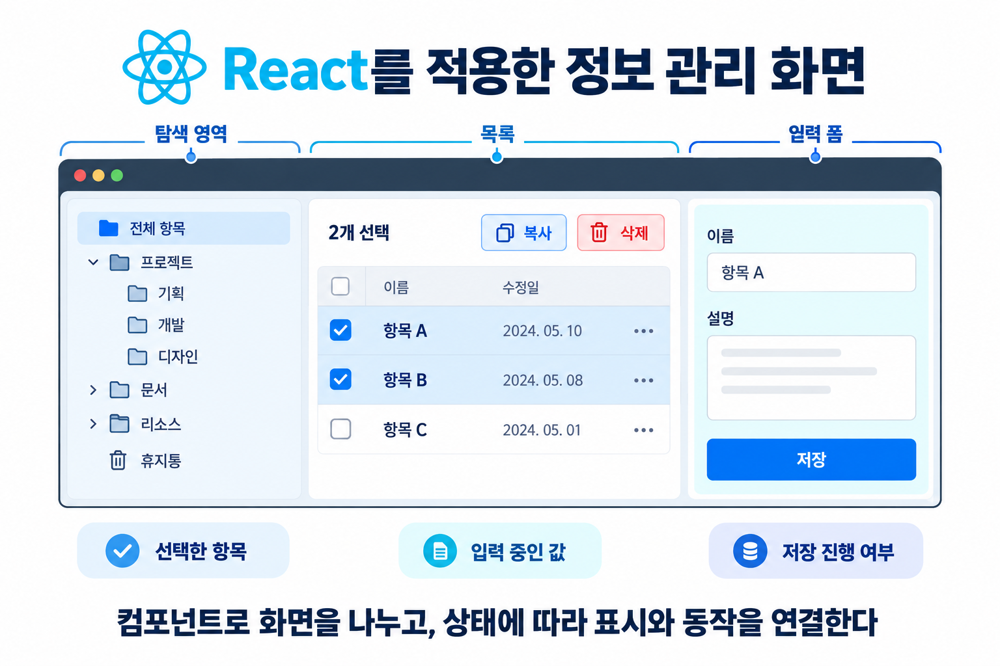

<!-- 유형: 기술 선택 (+ 개념 설명, 도구 비교) -->

# 02-1. 프론트엔드를 React로 선택한 이유

앞선 글에서는 비행 시험 데이터 플랫폼을 직접 개발하게 된 배경과 개발 범위를 설명했다. 이번 글에서는 웹 UI에 필요한 기능을 살펴보고, React의 특징과 도입 계기, 현재 시스템에 적합한 이유를 정리하려 한다.

반복적인 데이터 조회와 추출, 외부 분석 도구와의 연계에는 API를 주로 사용할 것으로 예상한다. 하지만 필요한 데이터를 간혹 내려받거나, 파라미터 정보를 확인하기 위해 매번 API 호출 코드를 작성하는 것은 번거롭다. 사업과 모듈별로 파라미터 DB를 확인하고 수정하거나, 파일을 등록한 뒤 데이터 처리 진행 상황을 확인할 수 있는 화면도 필요하다.

그래서 API로 기능을 제공하면서, 사용자와 관리자가 웹에서도 필요한 업무를 수행할 수 있도록 구성했다. 프론트엔드는 사용자 조작과 화면 표시를 담당하고, FastAPI로 구현한 API 서버에 조회·저장·처리 등의 작업을 요청한다.

## 화면에서 필요한 기능

세부 구조를 모두 설명할 수는 없지만, 데이터 업로드와 정보 관리 과정에서 여러 항목을 선택하고 복사하거나 삭제하는 기능이 필요하다. 사용자 편의성을 위해 윈도우 파일 탐색기와 유사한 형태를 추구했고, 버튼을 누르면 팝업에서 정보를 입력하는 등 사용자 조작에 따라 화면이 바뀌도록 구성했다.

예를 들어 여러 항목을 선택하면 선택된 항목을 표시하고, 복사나 삭제 기능도 해당 항목을 대상으로 동작해야 한다. 입력창을 열었다면 입력 중인 내용을 유지하고, 저장 결과에 따라 목록을 갱신하거나 오류를 표시해야 한다.

이처럼 하나의 조작이 여러 화면 요소와 연결되기 때문에, 현재 선택한 항목이나 입력 중인 정보에 맞춰 화면과 동작이 함께 바뀌어야 한다. 기능이 늘어나면 어떤 정보가 어떤 화면에 영향을 주는지도 관리해야 한다.

React는 이러한 관계를 상태와 컴포넌트로 표현할 수 있다는 점에서 현재 플랫폼에 적합한 도구라고 생각하고 있다.

## React의 핵심 개념

React는 사용자 인터페이스를 만들기 위한 JavaScript 라이브러리다. 즉 JavaScript로 화면을 구성하는 도구다. 핵심 개념은 이후 학습 글에서 자세히 다루고, 여기서는 간략하게 살펴보려 한다.

**1) 컴포넌트는 화면을 구성하는 단위다.**

버튼이나 입력창 등의 작은 영역부터 검색창과 목록을 포함한 큰 영역까지 컴포넌트로 만들 수 있다. 화면에서 차지하는 크기보다 기능과 책임을 기준으로 나눈다.

예를 들어 상품 검색 화면은 검색창, 상품 목록, 개별 상품으로 구분할 수 있다. 같은 형태의 상품 표시는 재사용하고, 검색창을 수정할 때는 해당 컴포넌트를 중심으로 코드를 살펴볼 수 있다.

컴포넌트에는 화면의 모양뿐 아니라 사용자 조작에 대응하는 코드도 들어간다. 정보를 입력하고 저장하는 컴포넌트라면 입력창과 저장 버튼을 표시하고, 입력값 변경이나 저장 버튼 클릭에 대응하도록 작성할 수 있다.

**2) 선언형 UI는 상태에 따라 화면이 어떤 모습이어야 하는지 작성하는 방식이다.**

JavaScript로 DOM(Document Object Model)을 직접 조작하려면 “버튼을 찾고, 비활성화하고, 문구를 변경한다”와 같은 절차를 작성해야 한다. DOM은 문서를 객체와 트리 구조로 표현한 것으로, JavaScript를 통해 내용을 조회하거나 변경할 수 있다.

React에서는 “저장 중이면 버튼을 비활성화하고 ‘저장 중’이라는 문구를 표시한다”는 관계를 작성한다. 상태가 변경되면 React가 이를 반영해 화면을 갱신한다.

**3) 상태와 props는 역할이 다르다.**

상태(state)는 컴포넌트가 기억하고 변경해야 하는 값이다. 입력 중인 검색어, 선택한 항목, 저장 진행 여부 등이 해당한다.

props는 부모 컴포넌트가 자식 컴포넌트에 전달하는 정보다. 표시할 데이터뿐 아니라 사용자 조작에 대응할 함수도 전달할 수 있다. 부모가 관리하는 상태를 자식에게 props로 전달하면 자식은 해당 정보를 화면에 표시할 수 있다.

자식이 전달받은 정보를 변경해야 한다면 부모가 전달한 함수를 호출해 변경을 요청한다. 전달받은 props를 직접 수정하지 않는다. 이러한 단방향 데이터 흐름은 값이 어디에서 관리되고 변경되는지 추적하는 데 도움이 된다.

## 프론트엔드 도구들을 어떤 기준으로 비교할 것인가

컴포넌트와 상태 기반 UI는 React만 제공하는 기능이 아니다. Vue, Angular, Svelte도 비슷한 문제를 각자의 방식으로 해결한다.

따라서 기능의 유무보다 화면 작성 방식, 상태와 입력을 연결하는 방법, 기본 제공 범위, 추가로 관리해야 할 구성을 비교할 필요가 있다.

아래 표는 글을 작성하면서 공식 문서를 참고해 정리한 추가 비교다. 당시 검토한 후보 목록이나 직접 측정한 성능 비교를 의미하지는 않는다.

| 도구 | 화면 작성 방식 | 상태와 입력 연결 | 기본 제공 범위와 추가 구성 |
| --- | --- | --- | --- |
| HTML과 JavaScript로 직접 구현 | HTML과 DOM 조작 코드 작성 | 이벤트를 받아 값과 DOM을 직접 갱신 | 라우팅과 공통 UI 구조 등을 필요에 따라 직접 구성 |
| React | JSX와 컴포넌트로 화면 표현 | 상태와 props, 이벤트 처리 함수 사용 | UI 구성을 중심으로 제공하며 라우팅 등은 별도 도구와 조합 |
| Vue | 템플릿 기반의 단일 파일 컴포넌트 등을 사용 | 반응성 시스템과 이벤트, `v-model` 등 사용 | 공식 라우터·상태 관리 도구 등을 필요에 따라 조합 |
| Angular | 컴포넌트와 템플릿으로 화면 구성 | 바인딩·이벤트와 폼 기능 사용 | 라우팅·폼·의존성 주입 등을 프레임워크에서 제공 |
| Svelte | 컴포넌트를 작성하고 실행 코드로 컴파일 | 반응성 문법과 이벤트, 바인딩 사용 | 앱 수준의 라우팅 등은 SvelteKit 같은 도구와 구성 |

JSX는 JavaScript 코드 안에서 HTML과 비슷한 형태로 화면 구조를 표현하는 문법이다. React에서는 이를 사용해 컴포넌트가 보여줄 화면을 작성할 수 있다.

표에 나오는 라이브러리와 프레임워크, 라우팅은 서로 다른 개념이다. 처음에는 화면을 만드는 도구라는 점에서 비슷하게 느껴졌지만, 각각 무엇을 담당하는지 구분할 필요가 있다.

## 프레임워크·라우터·컴포넌트의 차이

컴포넌트는 목록이나 입력 폼처럼 화면의 일부를 구현한 코드다. React는 이러한 컴포넌트를 작성하고 상태에 맞춰 화면에 반영하는 데 사용하는 라이브러리다. 입력 폼 컴포넌트는 React로도, Angular로도 만들 수 있다.

프레임워크는 애플리케이션을 만드는 기본 구조와 실행 흐름을 제공하는 도구다. 현재 API 서버에 사용하는 FastAPI를 예로 들 수 있다. 개발자가 주소와 처리 함수를 등록하면 FastAPI가 요청을 받아 해당 함수를 실행하고 반환값을 응답으로 보낸다. 개발자는 제공되는 구조 안에 조회나 저장 같은 기능을 작성한다.

프론트엔드 프레임워크인 Angular는 화면을 구성하는 방식과 함께 라우팅·폼 등의 기능을 제공한다. 프레임워크라고 해서 반드시 프론트엔드와 백엔드를 모두 담당하는 것은 아니다. FastAPI는 백엔드, Angular는 프론트엔드 개발에 사용하는 프레임워크다.

라우터는 주소에 맞는 화면이나 처리 함수를 찾아 연결한다. 주소를 보고 어떤 화면을 보여주거나 어떤 함수를 실행할지 결정하는 역할이다.

현재 플랫폼을 예로 들면 다음과 같다.

1. 사용자가 다운로드 메뉴를 누르면 React Router가 `/download`에 연결된 화면 컴포넌트를 선택한다.
2. 해당 컴포넌트가 목록과 버튼을 표시하고, 데이터가 필요하면 API 서버로 HTTP 요청을 보낸다.
3. FastAPI의 라우팅 기능이 주소와 HTTP 요청 방식에 맞는 조회 함수를 연결한다.
4. 조회 결과를 프론트엔드의 상태에 반영하면 React가 갱신된 데이터를 화면에 표시한다.

이 과정에서 서버로 요청을 전달하는 것은 HTTP 통신이다. 라우터는 주소에 맞는 화면이나 처리 함수를 연결한다.

모든 사용자 조작에 화면 이동이나 서버 요청이 필요한 것은 아니다. 체크박스를 선택하거나 팝업을 여는 동작은 프론트엔드의 이벤트 처리 코드가 상태를 변경하고, React가 이를 화면에 반영하는 것으로 처리할 수 있다. 이후 선택한 항목을 삭제하거나 입력한 내용을 저장할 때는 백엔드에 요청한다.

폼은 사용자가 정보를 입력하고 제출하는 영역이다. 로그인 화면의 아이디·비밀번호 입력창과 로그인 버튼을 생각하면 된다. 이 시스템에서는 정보를 추가하거나 수정하는 창이 해당한다. 입력값을 관리하고 필수 항목을 확인하며, 저장 결과나 오류를 표시하도록 구현한다.

이처럼 실제 웹 화면에는 UI 구성 외에도 여러 기능이 필요하다. React는 화면 구성을 중심으로 사용하고, 라우팅 등은 별도의 도구와 연결한다. Angular처럼 여러 기능을 함께 제공하는 방식을 사용할 수도 있다. 필요한 기능을 어떻게 구성할지, 개발과 유지보수를 맡을 사람이 해당 구성을 다룰 수 있는지도 선택 기준이 된다.

## React를 도입한 계기와 적용

일단 나는 비전공자이기도 하고, 개발을 처음 진행하는 것이기에 React를 도입할 때는 아는 것이 없어 이것저것 비교하지 않았다. 바이브 코딩으로 플랫폼을 개발하고 있기에 그저 Claude가 도입하길래 진행하고 나중에 공부하는 형식으로 진행하고 있다.

그래서 화면은 기존 시스템을 사용하면서 “이렇게 구현되면 좋겠다”고 느낀 점을 반영해 직접 디자인했다. 기존 시스템이 여러 개의 프로그램으로 나뉘어 있던 점을 개선해 하나의 시스템으로 구성하는 방향이었다. 다만 설계한 것은 화면이고, 이를 어떤 도구로 구현할지는 지정하지 않았다.

그렇다면 지금 시스템에 React가 잘 맞는 이유는 무엇일까?

*정보 관리 화면의 구성 예시. 실제 시스템 화면을 그대로 옮긴 것이 아니라 본문 설명을 위한 그림이다.*

이 시스템의 화면은 정보를 보여주는 것에서 끝나지 않는다. 여러 항목을 선택해 복사하거나 삭제하고, 수정창을 열어 정보를 입력한 뒤 저장해야 한다. 이때 선택 표시와 실제 작업 대상이 일치해야 하고, 저장한 내용은 목록에도 반영되어야 한다. 하나의 조작에 따라 함께 바뀌어야 하는 부분이 여러 곳에 있는 셈이다.

React에서는 선택한 항목이나 입력값을 상태로 관리하고, 그 상태에 따라 화면을 표시하도록 작성할 수 있다. 예를 들어 선택한 항목 정보를 기준으로 목록에 선택 표시를 하고, 복사나 삭제를 실행할 때도 같은 정보를 사용한다. 화면에 표시하는 내용과 작업에 사용하는 정보가 같은 상태를 기준으로 동작하도록 구성할 수 있다.

화면을 기능별로 나눌 수 있다는 점도 현재 구성과 잘 맞는다. 정보 관리 화면은 탐색 영역, 목록, 입력 폼 등으로 나뉘어 있다. 각 영역을 컴포넌트로 구성하면 입력창을 수정할 때와 목록의 표시 방식을 수정할 때 살펴볼 코드를 구분할 수 있다. 여러 영역에서 함께 사용하는 선택 정보는 상위 컴포넌트에서 관리하고 필요한 곳에 전달한다.

물론 모든 정보를 하나로 합치는 것은 아니다. 상세 정보를 보기 위해 열어 놓은 항목과 복사·삭제를 위해 선택한 항목 목록은 서로 다를 수 있다. 그래서 이 둘은 별도로 관리한다. 어떤 정보는 함께 사용하고 어떤 정보는 구분할지 먼저 정한 뒤, 이를 컴포넌트에 연결하는 방식이다.

또한 체크박스를 선택하거나 수정창에 내용을 입력할 때마다 서버의 데이터를 바꿀 필요는 없다. 선택 정보와 입력값은 프론트엔드에서 관리하다가, 사용자가 저장이나 삭제를 실행하면 API 서버에 요청한다. 요청 중인지, 완료됐는지, 오류가 발생했는지에 따라서도 화면을 다르게 표시할 수 있다.

다만 여기까지는 React가 이 시스템에 적합하다는 설명이다. Vue나 Svelte로도 비슷한 구성이 가능하므로, 다른 도구 대신 React를 선택해야 하는 결정적인 이유라고 보기는 어렵다. 처음부터 이런 특징을 비교해 선택한 것도 아니다.

현재는 필요한 화면과 동작이 React로 구현되어 있고, 다른 도구로 바꿔야 할 만큼의 제약은 아직 확인하지 못했다. 도구를 바꾸면 기존 기능을 다시 구현하고 검증해야 하므로, 지금은 현재 구성을 이해하고 필요한 부분을 개선하는 데 집중하려 한다. 구현된 코드를 공부하면서 React의 장단점과 다른 도구와의 차이도 함께 알아갈 생각이다.

## 적용 결과와 한계

현재 구현에서는 관리 화면을 기능별 컴포넌트로 나누고, 공통 선택 정보를 필요한 영역에 전달하고 있다. 다만 이러한 구조를 사용했다는 사실만으로 개발 시간이 줄었거나 오류가 감소했다고 판단할 수는 없다. 이 글에서는 현재 코드에서 어떻게 사용하고 있는지와 그 구성이 필요한 기능에 어떻게 연결되는지를 살펴봤다.

React를 사용하더라도 상태를 어디에서 관리할지, API 응답을 어떻게 반영할지, 어떤 라이브러리를 추가할지는 직접 결정해야 한다. 빌드와 의존성 관리도 필요하다. 이 부분은 02-3편에서 다룰 예정이다.

현재 프론트엔드는 React만으로 구성되어 있지는 않다. 화면 전환과 그래프, 스타일, 개발과 빌드에는 별도의 도구를 함께 사용하고 있다. 다음 글에서는 Vite, React Router, Recharts, Tailwind CSS 등이 각각 어떤 역할을 담당하고 React와 어떻게 연결되는지 살펴보려 한다.
